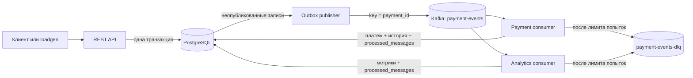

# B2B Payment Event Processing System

Учебный дипломный проект: «Разработка событийно-ориентированной системы обработки платежных данных с механизмом дедубликации информации в хранилище».

Проект демонстрирует приём синтетических финансовых событий, атомарное сохранение события с записью Outbox, передачу через Apache Kafka, идемпотентную обработку в PostgreSQL и подсчёт дневной статистики. Реальные банки, платёжные шлюзы и счета не используются.

## Цель и задачи

- Принимать события `payment.created`, `payment.succeeded` и `payment.failed` через REST API.
- Проверять схему и содержимое события, хранить денежные суммы в целых минимальных единицах.
- Обнаруживать повторное событие по `(source, event_id)` и фиксировать конфликт повторного ключа с другим содержимым.
- Надёжно передавать события из PostgreSQL в Kafka по Outbox Pattern.
- Обрабатывать at-least-once доставку без повторной записи платежа, истории и аналитических агрегатов.
- Собирать агрегаты по компании и дню.

## Архитектура

Проект использует четыре небольших процесса из одного Go-модуля. Это отдельные точки запуска, а не набор независимых микросервисов со своими базами.



| Компонент | Назначение |
| --- | --- |
| `cmd/api` | REST API, валидация, первичная дедубликация, запросы по платежам и метрикам. |
| `cmd/migrate` | Применяет SQL-миграции Goose перед запуском приложений. |
| `cmd/publisher` | Публикует неопубликованные записи Outbox в Kafka и отмечает подтверждённые записи. |
| `cmd/consumer` | Обновляет текущий платёж и историю переходов статуса. Consumer group: `payment-processor`. |
| `cmd/analytics-consumer` | Независимо агрегирует события. Consumer group: `payment-analytics`. |
| `cmd/loadgen` | Посылает синтетическую нагрузку и сохраняет измерения в JSON. |
| PostgreSQL | Источник истины для принятых событий, статусов, идемпотентности, Outbox и агрегатов. |
| Kafka | Асинхронный журнал событий; ключ партиционирования — `payment_id`. |

Последовательность обработки и модель дедубликации подробнее описаны в [docs/architecture.md](docs/architecture.md) и [docs/deduplication.md](docs/deduplication.md).

## Таблицы PostgreSQL

Миграция `migrations/001_initial_schema.sql` создаёт:

| Таблица | Содержимое и ограничения |
| --- | --- |
| `companies` | Синтетические компании; компания создаётся при первом событии. |
| `payments` | Текущее состояние платежа; один `payment_id`, сумма в minor units, валюта и статус. |
| `payment_events` | Принятый JSON, hash, тип и время события; `UNIQUE(source, event_id)`. |
| `outbox_events` | JSON для Kafka, статус публикации и сведения об ошибках; строка сохраняется после отправки. |
| `processed_messages` | Идемпотентность каждого consumer; `UNIQUE(consumer_name, source, event_id)`. |
| `payment_history` | Допустимые переходы статусов; на событие не более одной записи. |
| `ingestion_conflicts` | Входное содержимое и hash при повторном ключе с изменённым телом. |
| `company_daily_metrics` | Дневные количества событий, платежей, сумма, успешные и неуспешные операции. |

`total_payments` и `total_amount_minor` увеличиваются на `payment.created`. `succeeded_count` и `failed_count` считают уникальные соответствующие события. Все изменения метрик и ключ идемпотентности аналитики фиксируются одной транзакцией.

## Запуск локально

Нужны Docker с Docker Compose и Go 1.23+ (Go нужен для локальных тестов и `loadgen`). Контейнеры используют один Kafka broker в режиме KRaft без ZooKeeper. Это конфигурация для разработки, без отказоустойчивости и репликации.

```sh
cp .env.example .env
docker compose -f deploy/docker-compose.yml up --build -d
docker compose -f deploy/docker-compose.yml ps
curl -i http://localhost:8080/healthz
curl -i http://localhost:8080/readyz
```

Compose запускает PostgreSQL и Kafka, создаёт топики, применяет миграцию, затем поднимает API, publisher и обе consumer group. Для остановки:

```sh
docker compose -f deploy/docker-compose.yml down
```

Данные сохраняются в Docker volumes. `down -v` удалит локальные данные БД и Kafka.

### HTTP API

`POST /api/v1/payment-events` принимает событие. Время указывается в RFC3339, сумма — целым числом копеек (или другой минимальной единицы валюты).

```sh
curl -i http://localhost:8080/api/v1/payment-events \
  -H 'Content-Type: application/json' \
  -d '{
    "event_id":"evt-demo-001",
    "source":"synthetic-demo",
    "company_id":"company-demo",
    "payment_id":"payment-demo-001",
    "event_type":"payment.created",
    "amount_minor":125000,
    "currency":"RUB",
    "occurred_at":"2026-11-03T12:00:00Z",
    "schema_version":1
  }'
```

Ожидаемые ответы: `202 Accepted` для нового события, `200 OK` для полного дубликата и `409 Conflict` для того же `(source, event_id)` с отличающимся содержимым. Неизвестные поля и неверная схема отклоняются.

Другие endpoints:

| Метод и путь | Назначение |
| --- | --- |
| `GET /api/v1/payment-events/{event_id}?source=...` | Принятое событие. `source` нужен, если такой `event_id` есть у нескольких источников. |
| `GET /api/v1/payments/{payment_id}` | Текущий статус и данные платежа после обработки consumer. |
| `GET /api/v1/companies/{company_id}/payments?status=created&from=...&to=...&limit=100&offset=0` | Платежи компании с фильтрами по статусу и времени. Время RFC3339, `to` не включается. |
| `GET /api/v1/companies/{company_id}/metrics/daily?from=2026-11-01&to=2026-11-30` | Дневные агрегаты за включительный диапазон дат. По умолчанию — последние 30 дней. |
| `GET /healthz` | Проверка процесса API. |
| `GET /readyz` | Проверка доступности PostgreSQL. |

Ошибки API возвращаются единым JSON-объектом вида `{"error":{"code":"...","message":"..."}}`.

### Пример сообщения Kafka

Publisher отправляет JSON события в `payment-events`, устанавливая Kafka key в `payment_id`. Например:

```json
{
  "event_id": "evt-demo-001",
  "source": "synthetic-demo",
  "company_id": "company-demo",
  "payment_id": "payment-demo-001",
  "event_type": "payment.created",
  "amount_minor": 125000,
  "currency": "RUB",
  "occurred_at": "2026-11-03T12:00:00Z",
  "schema_version": 1
}
```

После трёх неудачных попыток consumer пишет исходное сообщение (в base64) и причину в `payment-events-dlq`, и только затем подтверждает исходный offset.

## Тесты

Unit-тесты запускаются командой:

```sh
go test ./...
```

PostgreSQL integration-тесты используют существующую локальную БД с уникальными синтетическими ID. Запустите их в контейнере внутри сети Compose:

```sh
docker compose -f deploy/docker-compose.yml run --rm integration-tests
```

Для запуска тестов с host Go process задайте `TEST_DATABASE_URL` вручную. Интеграционные тесты проверяют приём, дубль и конфликт, повторную обработку, откат при недопустимом переходе, независимые события платежа и сохранение Outbox до отметки публикации. Они пропускаются, если `TEST_DATABASE_URL` не задан.

При работающем Compose API и Kafka можно проверить скриптом `sh tests/e2e.sh`: он проверяет коды ответа API, перезапуск payment consumer, повторную Kafka-доставку, отсутствие повторного изменения истории/аналитики и попадание невалидного для обработки события в DLQ.

## Нагрузочные сценарии

Пример одного замера:

```sh
go run ./cmd/loadgen -events 10000 -companies 100 -payments 5000 -workers 32 \
  -duplicate-rate 0.1 -conflict-rate 0 -output results/run-10k-10pct.json
```

`loadgen` измеряет время, запросы/с, среднюю задержку, p95/p99 и фактические ответы API, затем сохраняет JSON. Для предусмотренных сценариев (1 000, 10 000, 100 000 событий; 0%, 10%, 30% полных дубликатов) запустите:

```sh
scripts/load-scenarios.sh
```

Для быстрого пробного запуска только 1 000 запросов на каждую долю дубликатов используйте `LOAD_SIZES=1000 sh scripts/load-scenarios.sh`.

Скрипт дожидается обработки каждого сценария и сохраняет фактические дельты строк `payment_events`, `outbox_events` и `processed_messages` в CSV рядом с JSON-файлами. Генератор также поддерживает одинаковый `event_id` с изменённым содержимым через `-conflict-rate`. Consumer lag снимается отдельно и сохраняется командой:

```sh
scripts/consumer-lag.sh
```

Фактические результаты прогонов на 1 000 и 10 000 запросов для 0%, 10% и 30% дубликатов сохранены в [results/README.md](results/README.md). Эти показатели относятся только к локальной машине; 100 000-событийный сценарий подготовлен, но не запускался.

Отчёты содержат только реальные измерения конкретного запуска. В `results/` не добавлены демонстрационные цифры. Для сравнения обработки подготовьте одинаковую среду, очистите или пересоздайте тестовую БД между сценариями и приложите JSON-отчёты вместе с файлом lag. Нагрузочные сценарии не выполняются автоматически при `go test`.

## Ограничения учебной реализации

- Kafka работает с одним узлом и replication factor 1; это не production-конфигурация.
- Outbox publisher намеренно один и отправляет упорядоченные пакеты до 100 записей. При сбое после Kafka ack, но до `published_at`, возможна повторная доставка.
- События с недопустимым переходом статуса после ограниченного числа попыток попадают в DLQ; требуется ручной разбор и повторное опубликование исправленного события.
- Компании создаются автоматически с `display_name = company_id`; авторизация, tenant isolation и управление справочником компаний не входят в учебный MVP.
- Нет подключения к реальным финансовым системам, расчёта балансов, ClickHouse, Prometheus и Grafana.
- `company_daily_metrics` хранит UTC-день события; статистика отражает уникальные события, полученные аналитической consumer group.
- API хранит только синтетические данные и не содержит механизма аутентификации.

## Структура

```text
cmd/{api,publisher,consumer,analytics-consumer,migrate,loadgen}/
internal/{api,analytics,config,consumer,database,deduplication,domain,kafka,logger,outbox,repository}/
migrations/
deploy/docker-compose.yml
docs/{architecture,deduplication}.md
scripts/
tests/
```
