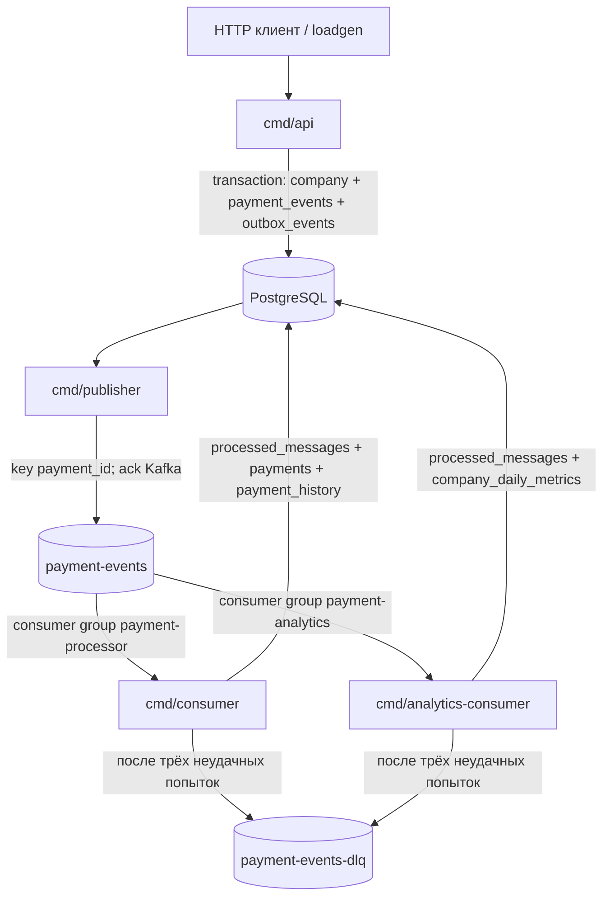

# Архитектура системы

## Состав

Система собрана как одно Go-приложение с отдельными entrypoint-командами. PostgreSQL хранит принятые события и является источником истины. Kafka разделяет приём и фоновые обработчики. Четыре процесса имеют ясную специализацию без сетевых вызовов между внутренними компонентами, кроме Kafka и PostgreSQL.



## Последовательность события

```mermaid
sequenceDiagram
    participant C as HTTP клиент
    participant A as API
    participant P as PostgreSQL
    participant O as Outbox publisher
    participant K as Kafka
    participant PC as Payment consumer
    participant AC as Analytics consumer

    C->>A: POST payment event
    A->>A: normalize, validate, SHA-256
    A->>P: BEGIN; insert company/event/outbox
    P-->>A: COMMIT
    A-->>C: 202 accepted
    O->>P: read pending outbox ordered by id
    P-->>O: payload + payment_id
    O->>K: publish(key=payment_id)
    K-->>O: broker acknowledgement
    O->>P: set published_at
    K->>PC: event (at-least-once)
    PC->>P: BEGIN; claim message; update payment/history
    P-->>PC: COMMIT
    PC->>K: commit offset
    K->>AC: event (independent group)
    AC->>P: BEGIN; claim message; upsert daily metrics
    P-->>AC: COMMIT
    AC->>K: commit offset
```

## Потоки и сбои

1. API проверяет обязательные поля, тип события и версию схемы. Новая компания регистрируется синтетическим upsert-ом.
2. `payment_events` и `outbox_events` записываются в одной транзакции. Если транзакция не завершилась, Kafka publisher не увидит частичное состояние.
3. Publisher отправляет упорядоченные пакеты до 100 сообщений; `payment_id` служит Kafka key. События одного платежа попадают в одну партицию, а Outbox читается по `id` одним publisher-ом.
4. Если Kafka подтвердила сообщение, но процесс упал до отметки `published_at`, запись остаётся pending и будет отправлена снова. Payment consumer обнаружит уже обработанный ключ в PostgreSQL.
5. Consumer сначала фиксирует бизнес-изменения и ключ идемпотентности в одной транзакции. Offset подтверждается после успешного commit. При DB-ошибке транзакция откатывается и offset остаётся неподтверждённым.
6. После заданного числа неуспешных попыток consumer публикует исходные байты в base64 вместе с ошибкой и координатами Kafka в DLQ. Исходный offset подтверждается только после ack DLQ. Это позволяет не блокировать partition одним poison message.
7. Analytics consumer имеет отдельную consumer group и отдельный ключ в `processed_messages`, поэтому он независимо читает события, не зависит от payment consumer и не увеличивает агрегаты повторно.

Перезапуск consumer восстанавливает позицию по committed offset. Если база уже зафиксировала сообщение, а подтверждение offset не успело выполниться, повторная доставка завершится идемпотентным no-op. Если транзакция БД не зафиксировалась, повторная доставка повторит работу.

## Статусы платежа

Поддерживаются состояния `created`, `succeeded`, `failed`. Первый обработанный event для платежа должен быть `payment.created`. Допустимы переходы `created -> succeeded` и `created -> failed`. Повтор того же целевого статуса не добавляет историю. Переход из terminal-статуса в другой статус считается ошибкой; после retry limit сообщение направляется в DLQ. Сумма, компания и валюта у разных событий платежа должны совпадать.

## Локальная инфраструктура

Docker Compose запускает PostgreSQL 16, Kafka 3.9 в KRaft и четыре Go-процесса. Скрипт `kafka-init` создаёт оба топика по три партиции с replication factor 1. ZooKeeper не используется. Один Kafka broker и один Outbox publisher подходят для знакомства с моделью, но не дают отказоустойчивости и не являются production-профилем.

## Проверка consumer restart и DLQ

Скрипт `sh tests/e2e.sh` проверяет API-дедупликацию, конфликт ключа, перезапуск payment consumer, повторную Kafka-доставку и DLQ. Он отправляет `payment.succeeded` для неизвестного платежа; consumer повторяет обработку и после лимита записывает его в `payment-events-dlq`. E2E-тест требует запущенный Compose и не запускается автоматически вместе с unit-тестами.
